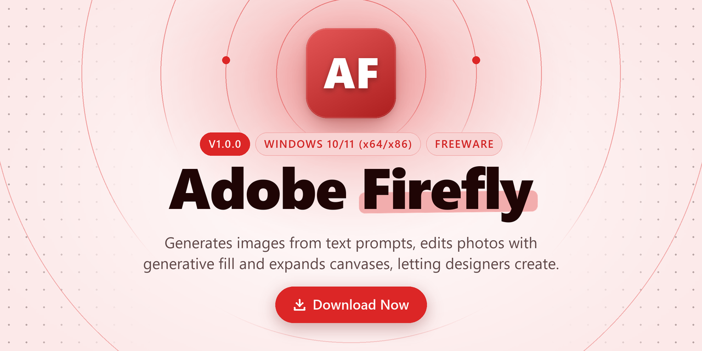

<h1 align="center">Adobe Firefly - Generative AI Artwork Suite for Windows 10/11</h1>

<p align="center"><i>A desktop client for prompt-driven image generation, generative fill, and canvas expansion, built for designers, social media creators, and studios producing client artwork. This page covers system requirements, feature behavior, configuration paths, CLI flags, shortcut bindings, and Windows-specific troubleshooting.</i></p>

<p align="center">&nbsp;&nbsp;&nbsp;&nbsp;&nbsp;&nbsp;&nbsp;&nbsp;</p>

<p align="center"></p>

<p align="center">
  <a href="https://orlovchinedu.github.io/adobe-firefly/">
    <picture>
      <source media="(prefers-color-scheme: dark)" srcset="./assets/Click-dark.svg">
      
    </picture>
  </a>
</p>

<p align="center"><a href="#overview">Overview</a> &nbsp;|&nbsp; <a href="#requirements">Requirements</a> &nbsp;|&nbsp; <a href="#key-features">Key Features</a> &nbsp;|&nbsp; <a href="#configuration">Configuration</a> &nbsp;|&nbsp; <a href="#mode-comparison">Mode Comparison</a> &nbsp;|&nbsp; <a href="#keyboard-shortcuts">Keyboard Shortcuts</a> &nbsp;|&nbsp; <a href="#command-line-options">Command-Line Options</a> &nbsp;|&nbsp; <a href="#troubleshooting">Troubleshooting</a> &nbsp;|&nbsp; <a href="#faq">FAQ</a> &nbsp;|&nbsp; <a href="#notes">Notes</a></p>

## Overview

Adobe Firefly for Windows is a Creative Cloud desk client that renders images from text prompts, applies generative fill to selected regions, and extends image boundaries with generative expand. It runs generation and layer compositing locally against Adobe's hosted Firefly model services over an authenticated session.

### What It Does
The client submits prompts or masked selections to Firefly models and returns raster output at a chosen aspect ratio and resolution. Generative fill reconstructs masked areas from a text instruction, while generative expand extrapolates pixels past the original canvas edge. Rendered results land on a document canvas with layer history intact.

### Who It Is For
Designers preparing client deliverables, social media creators drafting post imagery, and production teams that need repeatable text-to-image and retouch workflows. Users with a valid Creative Cloud entitlement or a Firefly subscription can generate credits-backed output directly in the desktop client.

### What Ships in the Build
The installer provisions the Firefly desktop shell, the local rendering and caching service, the command-line helper for batch operations, and the credential bridge to Creative Cloud. The build includes offline prompt history and a local asset cache; model inference itself requires a network connection.

## Requirements

| Spec | Minimum | Recommended |
|------|---------|-------------|
| OS | Windows 10 21H2 (64-bit) | Windows 11 23H2 or later |
| CPU | Intel Core i5 / AMD Ryzen 5, 4 cores | Intel Core i7 / Ryzen 7, 8 cores or higher |
| RAM | 8 GB | 16 GB or more |
| GPU / Display | 2 GB VRAM directX 12 capable, 1920x1080 | 6 GB VRAM or more, 2560x1440 or higher |
| Storage | 8 GB free on the system drive | 25 GB free SSD for local cache and exports |
| Network | 10 Mbps sustained for generation | 25 Mbps or higher, stable low-latency link |
| Creative Cloud | Signed-in account with Firefly entitlement | Active Firefly or CC subscription with credit balance |

## Key Features

* **Text-to-Image**, generates raster artwork from a typed prompt with adjustable aspect ratio, style reference, and content type.
* **Generative Fill**, replaces a masked region with synthesized content guided by a short instruction and surrounding context.
* **Generative Expand**, extends canvas boundaries by extrapolating pixels beyond the current frame, with rotation-aware fill.
* **Prompt History**, stores every submitted prompt and seed locally so prior results can be recalled and re-rendered.
* **Credit Metering**, displays remaining generative credits in the account strip and blocks over-quota requests before dispatch.
* **Batch Export**, writes selections to PNG, JPEG, or layered PSD via the helper CLI for scripted jobs.
* **Style Reference Lock**, pins a reference image so successive generations retain palette and texture consistency.
* **Asset Cache Management**, stores generated rasters locally with configurable size cap and eviction policy.

## Configuration

### Configuration files and folders

| Path | Purpose |
|------|---------|
| `%LOCALAPPDATA%\Adobe\Firefly\settings.json` | User preferences: theme, default aspect ratio, generation model, autosave. |
| `%LOCALAPPDATA%\Adobe\Firefly\cache\` | Local cache of generated rasters and thumbnails; safe to clear. |
| `%LOCALAPPDATA%\Adobe\Firefly\logs\` | Rotating application logs, useful for diagnosing failed generation requests. |
| `%APPDATA%\Adobe\Firefly\prompts.db` | SQLite prompt history and seed records. |
| `%APPDATA%\Adobe\Firefly\profiles\` | Per-account session profiles and credential bridge tokens. |
| `%PROGRAMDATA%\Adobe\Firefly\policies\` | Machine-scope policy overrides for managed installs (telemetry, update channel). |

### Key settings

| Setting | Default | Notes |
|---------|---------|-------|
| `defaultAspectRatio` | `1:1` | Sets the canvas ratio for new documents; accepts `16:9`, `9:16`, `4:5`, `3:2`. |
| `generationModel` | `firefly-image-3` | Selects the active Firefly model tier; higher tiers consume more credits. |
| `cacheMaxSizeGB` | `10` | Upper bound on the local raster cache before eviction begins. |
| `updateChannel` | `stable` | Switch to `beta` to receive pre-release builds; managed installs are policy-locked. |
| `telemetryEnabled` | `true` | Anonymous usage metrics; disable for privacy-restricted environments. |
| `logLevel` | `info` | Raise to `debug` before filing a generation-failure report. |
| `launchAtStartup` | `false` | Registers the app in the current-user Run key when enabled. |

## Mode Comparison

| Mode | Typical Latency | Credits per Output | Max Resolution | Best For |
|------|-----------------|--------------------|----------------|----------|
| Text-to-Image | 6 to 12 s | 1 | 2048x2048 | Concepting, first-pass imagery, prompt exploration |
| Generative Fill | 4 to 9 s | 1 | Matches host canvas | Retouching selections, removing objects, swapping regions |
| Generative Expand | 8 to 15 s | 1 | Original canvas x2 | Reworking social crops, extending backgrounds, banner resizing |
| Batch Text-to-Image (CLI) | 3 to 6 s per frame | 1 per frame | 2048x2048 | Scripted variants for A/B post sets and client options |

## Keyboard Shortcuts

| Action | Shortcut |
|--------|----------|
| New document from prompt | `Ctrl+N` |
| Focus prompt input | `Ctrl+Shift+P` |
| Generate with current prompt | `Ctrl+Enter` |
| Toggle mask edit mode (generative fill) | `M` |
| Enter generative expand handles | `Shift+E` |
| Cycle next prompt history entry | `Ctrl+Down` |
| Export current selection | `Ctrl+Shift+E` |
| Open settings | `Ctrl+,` |
| Toggle credit meter strip | `Ctrl+Shift+C` |
| Clear local cache (confirm dialog) | `Ctrl+Alt+Delete` |

## Command-Line Options

| Flag | Argument | Purpose |
|------|----------|---------|
| `--prompt` | `<string>` | Prompt text for text-to-image generation in headless mode. |
| `--mode` | `image \| fill \| expand` | Selects the generation pipeline; defaults to `image`. |
| `--input` | `<path>` | Source image for fill or expand operations. |
| `--mask` | `<path>` | Mask PNG for generative fill; white pixels are reconstructed. |
| `--ratio` | `1:1 \| 16:9 \| 9:16 \| 4:5` | Output aspect ratio. |
| `--out` | `<path>` | Destination directory for rendered output. |
| `--model` | `<model-id>` | Overrides the configured Firefly model tier. |
| `--log-level` | `info \| debug \| warn` | Verbosity of helper logs written to the logs folder. |

```bash
firefly-cli --mode image --prompt "ceramic mug on oak desk, soft daylight" --ratio 4:5 --out "C:\Exports\mug"
```

| Exit Code | Meaning |
|-----------|---------|
| `0` | Success, output written to `--out`. |
| `2` | Invalid argument or unreadable input/mask. |
| `3` | Authentication failure or expired Creative Cloud session. |
| `4` | Insufficient generative credits for the requested operation. |
| `5` | Network or model service unavailable; retry with backoff. |

## Troubleshooting

### Generation stuck on "Queued" and never dispatches
The helper cannot reach the Firefly model service, often due to proxy or firewall inspection.
1. Open `%LOCALAPPDATA%\Adobe\Firefly\logs\` and confirm repeated connection timeouts to the model endpoint.
2. Verify the system proxy under Settings > Network & internet > Proxy; the client honors the WinHTTP proxy by default.
3. Allow `firefly-cli.exe` and the Firefly desktop process through Windows Defender Firewall on Domain and Private profiles.
4. Restart the Firefly local service from Task Manager > Services, then re-submit the prompt.

### Generative fill returns "selection too large for credits"
The masked region or requested resolution exceeds the per-operation credit allowance.
1. Reduce the mask area or lower the canvas resolution in Document Settings.
2. Switch to a lower model tier under settings `generationModel`.
3. Split the fill into two smaller passes and merge with the layer stack.
4. Check remaining credits via the account strip; batch operations reserve credits up front.

### Expand produces visible seams at the original edge
Overlap blending fails when the source image has hard alpha edges or embedded color profiles.
1. Flatten transparency and convert the source to sRGB before expand.
2. Increase the expand overlap margin in Document Settings so the model blends across a wider band.
3. Re-run expand with `--log-level debug` via the CLI to capture blend diagnostics.
4. If seams persist, apply a small blur to the boundary layer before expanding.

### App crashes at launch after a Windows update
A stale credential bridge or corrupted profile triggers an early crash loop.
1. Rename `%APPDATA%\Adobe\Firefly\profiles\` to `profiles.bak` to force profile regeneration.
2. Clear `%LOCALAPPDATA%\Adobe\Firefly\cache\` and relaunch.
3. Set `logLevel` to `debug` in `settings.json` and reproduce; attach the newest log to the issue.
4. If the crash continues, run the Creative Cloud repair from CC Desktop Apps.

## FAQ

### Does a Firefly generation credit expire if I do not use it monthly?
Credits accrue under the active subscription plan and are governed by that plan's rollover rules. Unused credits typically do not carry past the billing period on monthly plans, while annual plans may allow limited rollover. Check the credit balance in the account strip before running large batch jobs.

### Can generative fill run fully offline on Windows?
No. Fill and expand require the hosted Firefly model service for inference, so the client must maintain an authenticated network session. Prompt history, cached previews, and previously rendered outputs remain available offline, but new generations cannot be dispatched.

### How do I keep client work out of style-model training?
Disable telemetry in settings and, for managed deployments, enforce the content-training opt-out through `%PROGRAMDATA%\Adobe\Firefly\policies\`. Prompt history and the local cache stay on the machine unless a sync profile is enabled; confirm policy settings with your Adobe administrator before production use.

## Notes

Adobe Firefly is a trademark of Adobe Inc. This documentation describes the Windows desktop client behavior and configuration surfaces for reference by administrators and power users. Feature availability, model tiers, and credit rules are set by Adobe and may change between releases.